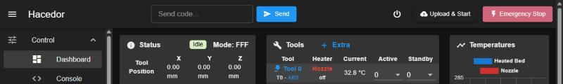
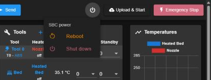
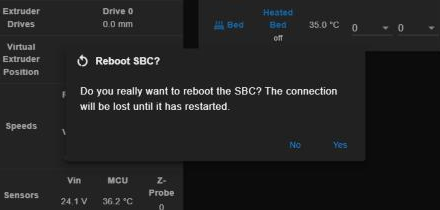

# SbcPowerButton

A Duet Web Control (DWC) plugin that adds a power button to the top app bar for rebooting or shutting down the single-board computer (Raspberry Pi) that runs Duet Software Framework.



It does the same as DWC's own buttons under **Settings → About**, but from anywhere in DWC: it sends `M999 B-1` (reboot) or `M999 B-1 P"OFF"` (shut down), which the DuetPi Management Plugin turns into a reboot or power-off of the SBC.

## What it looks like

| Menu | Confirmation |
|---|---|
|  |  |

- Every action asks for confirmation first.
- The button is disabled while printing (including paused), while DWC is disconnected or busy, or when the DuetPi Management Plugin is not running. The state is checked again after you confirm, so a print that started while the dialog was open is not interrupted.
- It is hidden when DWC is connected directly to a Duet board (no SBC).
- It follows DWC's "large buttons" setting.

## Compatibility

| Component | Supported | Tested |
|---|---|---|
| DuetWebControl | **3.7.x** (the plugin declares `dwcVersion: "3.7"`, which DWC matches against any 3.7 release) | 3.7.0 |
| Duet Software Framework | 3.7.x, SBC mode | 3.7.0 |
| DuetPi Management Plugin | Installed and running (ships with DuetPi images) | 3.7.0 |
| RepRapFirmware | Any version supported by DSF 3.7 (the commands are handled on the SBC, not by the firmware) | 3.7.0 on a Duet 3 Mini 5+ |

Not compatible:
- **DWC 3.6 and earlier.** Their plugin system (Vue 2, webpack) is different; DWC refuses to load this plugin there.
- **DWC 3.8 and later** until checked: DWC will refuse to load it, because the version is matched on major and minor. A new release of this plugin is needed after checking the new DWC.
- **Standalone Duet boards** (no SBC): the button stays hidden, since there is no SBC to power off.

## Installing

1. Download `SbcPowerButton-<version>.zip` from the [releases](https://github.com/DonEste/SbcPowerButton/releases).
2. In DWC go to **Settings → Plugins**, upload the zip, start the plugin and turn on auto-start.

To remove it, stop or uninstall it in the same tab; the button disappears.

Note: loading any third-party plugin makes DWC load its extra component bundle (about 150 KB), which costs a few MB of browser memory. This matters only on very small devices, such as a kiosk browser running on a Raspberry Pi 3.

## How it works

DWC 3.7 has no plugin API for the top bar, so the plugin places a small host element into the bar (just left of the emergency stop) and renders its Vue component there with DWC's own app context, so it uses DWC's styling, stores, translations and confirmation dialog. If DWC redraws the bar, the plugin puts the button back. Stopping the plugin removes it. More background, and the alternatives considered, are in [docs/RESEARCH.md](docs/RESEARCH.md).

Known limitation: DWC's confirmation dialog focuses **Yes** by default (the same as DWC's own power buttons), so a keyboard user pressing Enter repeatedly can confirm quickly.

## Building

1. Check out DuetWebControl at the version you target and install its locked dependencies:
   ```bash
   git clone --branch v3.7.0 --depth 1 https://github.com/Duet3D/DuetWebControl.git
   cd DuetWebControl
   npm ci
   ```
2. From inside that checkout, build this plugin:
   ```bash
   node scripts/build-plugin-pkg.js /path/to/SbcPowerButton
   ```
   This type-checks the sources and writes `SbcPowerButton-<version>.zip` into the plugin folder.

## License

GPL-3.0-or-later, the same license as DuetWebControl.
